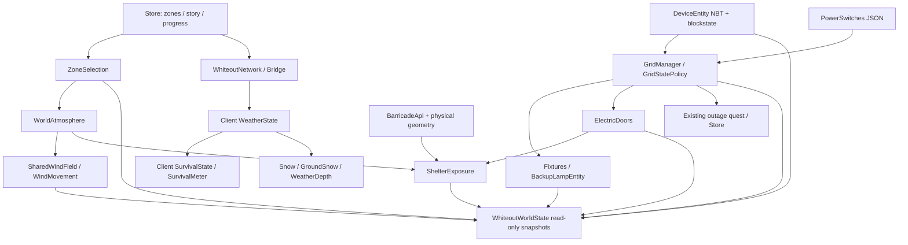

# Whiteout: аудит и проект WorldState

Дата: 2026-10-22. Основа: восстановленные исходники 3.12.9, исправления
баррикад 3.12.10, коммит `d224542`. Этот этап меняет только документацию.

## Границы доказательств

Проект — overlay поверх `base/Whiteout-3.4.2-1.21.1.jar`, а не полный исходный
проект. `build.gradle` компилирует дополнение и при выпуске объединяет его с базой,
патчит некоторые методы ASM и entrypoints. Поэтому одного просмотра Java overlay
недостаточно. База была декомпилирована CFR 0.152 во временный каталог, в том числе
Store, Zone, ZoneSelection, WeatherState, SurvivalState, WhiteoutNetwork, StoryRules,
DirectorActors и Plot. Обозначение `base!/...class` ниже указывает на проверенный
путь внутри этой базы; это не отсутствующий Java-файл репозитория.

Компиляция не запускает финальную ASM-сборку. Полный JAR по заданию не создавался.
Не заявляются игровые проверки, FPS/TPS или успешная загрузка dedicated server.

## Карта и источники истины

Все пути overlay ниже относительно `src/main/java/dev/whiteout/`.

| Подсистема | Реальные классы / вход | Источник истины и обновление | Сохранение / синхронизация | Связи и точка WorldState |
|---|---|---|---|---|
| Зоны | base!/dev/whiteout/Zone.class, ZoneSelection.class; power/WorldAtmosphere.java: weather/shelter | Store.data.zones; выбор по priority, размеру, id, contains/exclusions; редактирование через WhiteoutNetwork и EditorHistory | whiteout-zones.json; WhiteoutNetwork.sync → клиентский Bridge.snapshot | Читать существующий ZoneSelection; возвращать копии скалярных полей, не Zone |
| Метель и переходы | base!/dev/whiteout/client/WeatherState.class: tick; build.gradle hooks ZoneSeamRepair, EnvironmentClient | Сервер хранит настройки зон; клиент хранит сглаженные snow/storm/shelter, handoffFrom, missingWeatherTicks | Переходные значения не сохраняются; зоны синхронизируются существующими payload | Серверный снимок — параметры активной зоны, НЕ точное изображение клиентского перехода |
| Ветер | power/SharedWindField.java, WindMovement.java: tick/register; EnvironmentNetwork.java | WorldAtmosphere.get(server).windStrengthPercent + world time + зона; WindMovement каждые 5 тиков | whiteout-atmosphere.json; EnvironmentNetwork.Settings; атрибут скорости Minecraft | Переиспользовать SharedWindField без своих таймеров и случайности |
| Позёмка/рендер | power/GroundSnow.java, GroundSnowPolicy.java, GroundSnowConfig.java, GroundSnowWindSource.java, WeatherDepth.java, PowerClient.java | Клиентские частицы и настройки, общий SharedWindField; отдельные глубина/шэйдерные проходы | Клиентская конфигурация; состояние частиц transient | Сервер не импортирует эти клиентские классы; в API только общий ветер |
| Укрытия | power/ShelterExposure.java: measure; WorldAtmosphere.temperature; EnvironmentClient.applyShelter | Zone.shelter + 13 ограниченных лучей, максимум 20 шагов каждого; стекло, открытые двери и BarricadeApi | Сама экспозиция transient; параметры атмосферы в JSON | Переиспользовать measure, кешировать только результат ограниченное время; выгруженный чанк останавливает луч |
| Холод/восстановление | base!/dev/whiteout/client/SurvivalState.class и dev/whiteout/SurvivalMeter.class | meter.cold/stamina живут НА КЛИЕНТЕ; exposure от Zone.cold/weight, shelter; тепло ищется около игрока каждые 10 тиков | В Store нет серверного meter.cold; существующей авторитетной синхронизации этого счётчика не найдено | Накопленный холод серверу НЕДОСТУПЕН; нельзя создавать второй SurvivalMeter. Доступны параметры зоны/температура среды, с явно указанной семантикой |
| Генераторы/предохранители | power/DeviceEntity.java: tick/interact/setActive; DeviceBlock.java | BE fuel/fuse/burnt/unstableFuse, blockstate ACTIVE; старый kind=3, новый kind=0, щиток kind=1 | NBT и штатные BE updates; стартер PowerNetwork | Читать только загруженный BE; не запускать sync/setActive/markDirty/refresh |
| Независимые сети | power/GridManager.java: register/refreshOne/sampleDevices; GridStatePolicy.java | основной Config и NetworkStore.grids; observed facts сохраняются для выгруженных устройств; pending outage flags и flickerEnd | whiteout-grid.json + whiteout-grid-networks.json; GridFileIO; устройства и свет обновляются на сервере | Нужен узкий доступ к одной существующей Config; чистая оценка через GridStatePolicy, без sampleDevices |
| Выключатели | power/PowerSwitches.java: toggle/edit/allows | Data.switches и Entry.on/all/targets/network; операции на серверном потоке | whiteout-light-switches.json; Snapshot/Edit payload | Копировать bindings/скаляры, использовать существующее allows; не создавать свой реестр |
| Аварийные лампы | power/BackupLampEntity.java: tick/setGridPower/unlink; BackupLampPolicy.java | charge, linked, gridPowered, switchEnabled и LIT | BackupCharge/PowerLinked/GridPowered/SwitchEnabled в NBT; BE updates | Добавить только read-only getters закрытых полей, считывать свежие факты |
| Электрические двери | power/ElectricDoors.java: bind/locked/tick | JSON-привязка нижнего блока к сети + blockstate OPEN; поддержаны железные/медные двери | whiteout-electric-doors.json; DoorGateSync | Не вызывать locked из WorldState: через networkPowered он способен сохранять Config; читать binding и чистый snapshot сети |
| Обычные двери | power/AutoClosingDoors.java, AutoDoorPolicy.java | transient OPEN/PENDING; дедлайн 210 тиков; исключены управляемые двери, питание redstone, занятый проход | Таймеры не сохраняются; повторное обнаружение после загрузки | WorldState читает blockstate; не вызывает discover/close |
| Засовы/замерзание | power/bolt/DoorBolts.java; power/WorldAtmosphere.java | Bolt записи нижнего блока; freezingDoors/doorStates, coldTicks, attempts, lastAttempt | whiteout-door-bolts.json, whiteout-atmosphere.json; near-player sync | Не менять эти хранилища; для расширенного API нужен отдельный безопасный серверный accessor |
| Баррикады | power/barricade/BarricadeBlock.java, BarricadeConnections.java, BarricadeSupport.java, BarricadePlanner.java, BarricadeModels.java | BlockState FACING/PART/VARIANT; соединения вычисляются из соседей; scheduledTick перепроверяет поддержку перед breakBlock(true) | Штатные blockstates; новые поля не добавлялись | Dynamic collision, <=4 cuboids; BarricadeApi coverage оставлен прежним, чтобы не менять баланс ветра |
| События/задания | base!/dev/whiteout/StoryRules.class, net/WhiteoutNetwork.class, director/DirectorActors.class, plot/Plot.class; GridManager trigger | Store.data.storyVariables/objectives/completedEvents/plots/checkpoints; actor sessions transient; main circuit имеет свой outage trigger | Store.save/networkSnapshot, existing WhiteoutNetwork payload; GridManager quest flags | Будущий потребитель WorldState, не новый управляющий сценарий; текущий director не переписывается |
| Диалоги | power/DialogueCatalog.java, StoryDialogueHud.java; base клиентский DialogueManager | Клиентский registry SCRIPTS (DialogueCatalog использует reflection); сервер инициирует события существующими пакетами | DialogueManager.saveScript; файлы авторских сценариев | Не загружать DialogueCatalog в серверный API и не пытаться сделать его серверным источником |
| Сохранения/Undo | base!/dev/whiteout/Store.class; power/GridFileIO.java, EditorHistory.java, EditorDelta.java, ZoneFolders.java | JSON DTO + BE NBT; Undo per connection/dimension ограничен 30 операциями/2 MiB | Валидация Store version=1; defaults для старых полей; atomic replace где поддержан; повреждённые файлы блокируют запись | WorldState не имеет собственного файла и никогда не вызывает save/persist |

## Граф зависимостей

Нет обратной стрелки API → игровое состояние. Инвалидация не вызывает refresh,
save или события изменения питания. Это исключает рекурсивное обновление сетей.

## Конкретные проблемы

1. `GridManager.networkPowered` вызывает sampleDevices → persist при изменении
   наблюдаемых фактов. Комментарий read-only описывает намерение потребителя, но
   метод не годится для строго read-only диагностики. Не менять его старую механику;
   новому API использовать GridStatePolicy с копиями текущих/сохранённых фактов.
2. diagnosticConfigs делает JSON roundtrip всех сетей. PowerDiagnostics дополнительно
   обходит nearby chunks и все зоны/bindings. Нельзя использовать этот путь каждый тик
   или для запроса одного генератора. Config имеет публичные mutable поля; нельзя
   отдавать их вызывающему коду.
3. Серверные погодные параметры и клиентское сглаженное изображение имеют разную
   семантику. WindMovement выбирает зону у глаз, затем у ног; WorldAtmosphere выбирает
   в центре блока; WeatherState содержит handoff и плавные коэффициенты. API обязан
   указывать точку измерения и возвращать серверные параметры, не имитировать transition.
4. Накопленный холод не авторитетен на сервере. Честное `UNAVAILABLE` предпочтительнее
   нуля или второй симуляции. Перенос холода требует отдельного изменения механики.
5. WorldAtmosphere.choose скрывает exceptions как отсутствие зоны; API должен до
   выбора проверять Store.error и отличать повреждённые данные от пустой зоны.
6. Load helpers возвращают безопасные defaults после ошибок. Нужно отличать
   UNAVAILABLE (ошибка хранилища), MISSING, UNLOADED, UNBOUND, CACHED и AVAILABLE.
7. Счётчики ticks некоторых систем статические, поэтому нельзя использовать их
   как время жизни WorldState между серверами. Привязать кеш к экземпляру сервера
   и server ticks; очищать на SERVER_STOPPED, без удержания мира после остановки.
8. Финальная сборка содержит ASM-патчи и выборочный список включаемых классов.
   Размещение нового API под dev.whiteout.power гарантирует включение существующим
   правилом; новый общий корневой пакет потребовал бы обновления allowlist.

## Предлагаемый контракт

`power/WhiteoutWorldState.java` — один facade на сервер, методы только серверного
потока. Вложенные immutable records служат типизированными views, без менеджера на
каждый тип: WeatherStateView, ZoneStateView, ShelterStateView, PowerNetworkStateView,
GeneratorStateView, FuseStateView, DoorStateView, EmergencyLightStateView.

Каждый запрос имеет тик измерения, availability и immutable данные. Отсутствующий
объект не заменяется ложным «выключено». Списки копируются; наружу не выходят Config,
Zone, ItemStack, BlockEntity, World или mutable BlockPos. Адрес — dimension + int xyz.

Пример API: `WhiteoutWorldState.of(server).network("main")`,
`generator(world, pos)`, `weather(world, pos)`, `shelter(player)`, `door(world,pos)`.
Никаких save/update setters. На чужом потоке — IllegalStateException вместо гонки.
Для накопленного холода — отдельная availability UNAVAILABLE и OptionalDouble.empty.

## Кеширование и события

- Генератор, предохранитель, дверь, лампа читаются напрямую из уже загруженного чанка.
  Никакого сохранённого второго состояния, chunk tickets или getChunk с загрузкой.
- Снимок сети: lookup одной Config, два device lookup, immutable список только её
  fixtures. Ограниченный кеш (не более 128 запросов), срок 1 server tick. Существующий
  refresh/refreshOne и lifecycle/chunk events инвалидируют его без повторного расчёта.
- Укрытие: ключ включает dimension и точную позицию глаз, TTL до 5 server ticks,
  максимум 128 результатов; новая точка/зона не наследует чужой результат. Погодные
  зоны и параметры читать заново, кешировать только expensive ray sample.
- Инвалидация на chunk load/unload не читает блоки внутри callback. Удаление блока
  игроком тоже сбрасывает кеш; прочие изменения покрывает короткий TTL.
- TTL проверяется при чтении, поэтому даже пропущенное событие не возвращает
  бесконечно старые данные. Нет нового END_SERVER_TICK обхода всех сетей/зон/чанков.
- Серверное завершение удаляет facade/cache; retained facade должен отклонять запросы.
- Новых сетевых пакетов не требуется: первая версия API предназначена серверным
  потребителям. Существующие визуальные пакеты и настройки остаются как есть.

## Обратная совместимость и риски

Не менять имена blockstates, NBT, JSON schema, ids сетей, fuel units, fuse thresholds,
параметры ветра, музыкальные ресурсы, binding keys или поведение выгруженных сетей.
Сохранённые observed facts для выгруженного устройства допустимы только с явным
статусом CACHED; сам генератор UNLOADED, а не исчезнувший. Не запускать миграцию
или save при запросе. Ошибки старых файлов не исправлять новой сериализацией.

Один shelter sample ограничен ~260 проверками, но число запросов от будущего
потребителя всё равно важно. Кеш не ограничивает число уникальных запросов за тик;
директор обязан иметь свой бюджет. Копирование fixtures линейно по размеру одной
сети. Нельзя заявлять улучшение TPS без рабочего игрового стенда. Existing
AutoClosingDoors scan и GridManager global refresh — существующая нагрузка, не
повод переписывать их в этом этапе.

## План внедрения и проверок

1. Добавить records и маленький ограниченный TTL cache с injectable tick в тестах.
2. Добавить package-private accessor одной Config без JSON roundtrip и записи.
   Добавить только read-only getters полей лампы/привязки двери и статуса ошибки.
3. Связать существующие refresh и chunk/lifecycle callbacks с инвалидацией.
4. Читать погоду/зоны существующим selector, ветер SharedWindField; отдельно
   документировать unavailable client-only cold. Не создавать второй Store.
5. Тестировать actual GridStatePolicy и snapshots: fuel/running, fuse outage,
   две независимые сети, missing/unloaded device, неизвестный мир, immutable lists.
6. Детерминированные cache tests: hit, expiry, clock reset, outage invalidation,
   eviction, world lifecycle/recreation, no recursive load, loader failures.
7. Реальный ZoneSelection: смена зоны, отключение, dimension, приоритет,
   вложенность, исключения. Проверка отсутствия client imports и persistence calls
   дополняет, но не заменяет поведенческие тесты.
8. CompileJava + check + foundationTests; Minecraft bootstrap probe отдельно.
   Загрузка старого мира/удаление BE/chunk unload на настоящем сервере требуют
   Fabric runtime; synthetic cache tests не выдавать за игровые испытания.

WinterCrisisDirector, «Чёрная ночь», новые задания/погодные эффекты и изменения
баланса не входят в эту реализацию.
